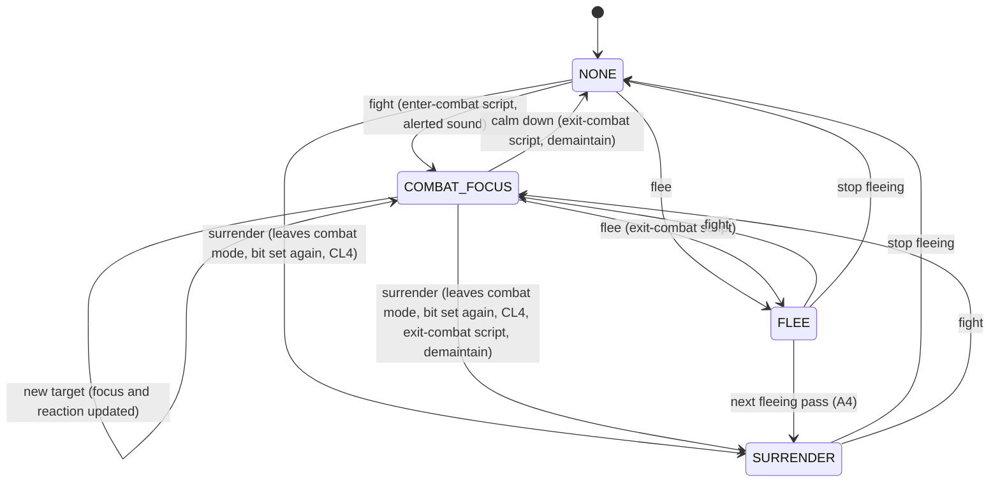

# NPC AI core loop

Status: **Research**, work item ARC-RES-054 (2026-10-18), stage A1 of the
[NPC combat AI plan](npc-combat-ai-plan.md#research-stages-source-reading-one-document-each)
(source units S1–S5). It fixes, for one NPC, where the AI parameters come from and
what each one feeds, when the AI runs in real time and in a turn-based round, the
order of one AI pass, and the four danger states with every flag, script and side
effect of their transitions. It changes no code. The rules it states are inputs
for implementation slices I1 (parameters), I3 (danger state) and I6 (tick and
turn-based hooks) of the plan.

Earlier facts reused here: the [load map](combat-domain-load-map.md) (ARC-RES-040:
two load phases, rows by position), the implemented
[AI parameter table](../world/ai-parameters.md) (ARC-DATA-033: rows read as the
original fills them, follow fields 5..8), the [data census](combat-data-census.md)
(ARC-RES-041: rows 0..40 and 100 exist, no NPC uses a row above 40), the
[script event dispatcher](scr-event-dispatcher.md) (ARC-RES-042: heartbeat and
combat script points, triggerers), the [event queue](game-event-queue.md)
(ARC-RES-046: the AI event is a game-time event that is never saved) and the
[combat core](combat-core-evidence.md) (ARC-RES-030: action points, rounds).

## Method

Behaviour comes from the retail executable (`Arcanum.exe` 1.0.7.4, SHA-256
`9bd80511…78d52`), read statically with `llvm-objdump` by a first reader and,
independently, by a second reader that saw only the questions
([method step 6](original-executable-check.md)). Function names are the
descriptive names the project uses for these addresses; object field numbers
were named from the executable's own field name table (0x59BEA8). The rows and
verdicts are in the [ledger](ledger/npc-ai.md#npc-ai-core-loop-arc-res-054).
Everything below is read from the executable unless marked **(inference)**.
Readings of the functions that only *consume* a parameter (stages A2–A7) are
marked as such: this note fixes which function reads which parameter slot, not
the full rule of that function.

## Answer

1. **Parameters are 17 integers per row, by position (S1).** The base file
   fills rows from its entry 0 up to row 99, the module file from its entry 100
   up to row 149; each next entry takes the next row whatever its number. An NPC
   copies the row its AI-data field names, without a bounds check. Fifteen
   functions read the row; the [dictionary](#4-parameter-dictionary) names, for
   every slot, the functions that read it and what they compare.
2. **Real time: one AI event per NPC (S2).** The event runs the first-heartbeat
   script on a wake-up, then, for a living NPC within 30 tiles of the PC outside
   a turn-based round, the heartbeat script; only if that returns "continue"
   does the NPC think (or a generator spawn). The next event comes after
   `250 + 4750 × d / 30` ms, `d` the distance to the PC capped at 30, plus
   0..5000 ms after a wake-up ([cadence](#2-cadence)).
3. **Turn-based: the subturn drives the AI (S5).** The real-time event still
   fires but never thinks during a round. At the start of an NPC's subturn the
   heartbeat runs and, on "continue", one AI pass; the same pair runs again
   after every animation the NPC finishes in its subturn. When no animation runs
   after that hook (also when the heartbeat stopped the pass), the NPC's action
   points become 0 and its subturn ends.
4. **One pass has a fixed order (S3).** Early exits, then a gate of fifteen
   tests (dead, hidden, PC hidden, stoned, in a conversation, combat scripts,
   someone else's turn, busy animation, blind and crippled recovery, stun,
   unconscious, generator, re-wield, demaintain), then heal, else item search,
   else danger update, then perform ([pipeline](#3-one-pass)).
5. **Four danger states, one setter (S4).** The state is NONE, COMBAT_FOCUS,
   FLEE or SURRENDER, read from two critter flags and one NPC flag in that order
   of precedence. Every transition goes through one setter, which applies the
   invulnerability, no-flee, charismatic-leader, global-switch and no-attack
   rules, writes the flags and handles, starts the enter-combat or exit-combat
   script and the alerted sound, and lowers the NPC's reaction toward a PC
   enemy to parameter 10 ([state machine](#5-danger-state-machine)).
6. **Anomalies.** P5 (combat scripts every pass) is the original's design and is
   kept. LM3 (rows by position) is a latent bug of the original; LM4 (empty
   unload) is the original's. Two differences of the reconstruction were found:
   it lets a still-stunned NPC act (CL1) and keeps the weapon re-wield flag
   after a full re-wield (CL2); the original does neither. Two bugs of the
   original were found: surrender leaves the combat-mode flag set because the
   setter writes back flags it read before leaving combat mode (CL4), and the
   gate's recoveries write back flags read before the combat scripts ran (CL5).
   The original also stops AI work on a network client (CL3), which does not
   apply to single player ([anomalies](#7-anomalies-and-decisions)).

## 1. Entry points

| Event | Mode | What runs | Function (address) |
| --- | --- | --- | --- |
| AI event of the NPC | real time | the tick ([section 2](#2-cadence)); thinks only outside a round | AI event (0x4AD200) |
| A sector's objects are folded in (sector load) | both | an immediate AI event marked "wake-up" for every NPC that is not destroyed ([main-map streaming SS7](ledger/world.md#main-map-streaming-arc-data-030)) | immediate event (0x4AD790), from the fold (0x441FC0) |
| An NPC is created or placed into a sector | both | a normal AI event after the distance delay; not in the editor | delayed event (0x4AD6E0), from object placement (0x442260) |
| A dead non-PC critter is resurrected | both | a normal AI event after the distance delay | delayed event (0x4AD6E0), from the heal step (0x4B58C0) |
| Start of a non-PC subturn | turn-based | action points `max(5, Speed)`, then heartbeat; on "continue" one AI pass; no animation left → action points 0, subturn ends | turn set (0x4B6E70), subturn hook (0x4B7010) |
| A critter's animation ends during a round | turn-based | the same subturn hook, which acts only for the critter whose turn it is and only for a non-PC | animation event (call at 0x423B8D) |
| End of a non-local-PC subturn | turn-based | the end-combat script of that critter | subturn end (0x4B7630) |
| An NPC is missed by a ranged or melee attack, or damaged without dying | both | one AI pass at once | ranged hit (0x4B2F60, call at 0x4B30F5), melee attack (0x4B3770, call at 0x4B3948), damage step (0x4B4390, call at 0x4B52FC) |
| The PC gives its followers an order (attack, walk, back off and the others) | both | one AI pass for each ordered follower after the order is applied (stage A7) | follower orders (0x4C31A0, call at 0x4C389D) |

In a round, the immediate pass of an attacked NPC whose turn it is not stops at
the gate's turn test (gate step 7). Because the combat scripts run before that
test (gate step 6), an NPC in combat mode runs its start-combat script whenever
it is attacked, in or out of its turn.

## 2. Cadence

The AI event is a game-time event of the replace kind: scheduling one first
removes the NPC's pending AI event ([event queue](game-event-queue.md), row AI).
It carries the NPC and a wake-up marker.

**The tick (0x4AD200).**

1. A network client returns at once and schedules nothing (CL3).
2. A null NPC: nothing.
3. Wake-up marker set and NPC alive: the NPC gets the "check wield" flag; a
   leaderless NPC outside combat mode runs its waypoints, else its standpoints;
   the first-heartbeat script runs (attachment point 10, the NPC as triggerer
   and attachee). Anything but "continue" skips to step 5.
4. If the NPC is alive, no round is running and it is within 30 tiles of the PC
   (the nearest player in a network game), the heartbeat script runs (point
   19). On "continue": a generator NPC asks the spawner, which on success names
   the time of the next event (scheduled, done); on failure an encounter
   creature is destroyed outside a round and no event is scheduled. Any other
   NPC gets one AI pass ([section 3](#3-one-pass)). Whatever the heartbeat
   returned, the next event is scheduled (step 6).
5. Otherwise (skipped, dead, in a round or farther than 30 tiles): outside a
   round a living NPC's running animations are interrupted (the helper is
   called with priority 4; what it keeps is the animation stage's question);
   then a
   PC follower more than 30 tiles from its PC leader that is alive, not told to
   wait, not paralysed and active is moved to the leader's location (in a
   network game its conversation is ended first). If it was moved, or its
   sector is loaded, the next event is scheduled; otherwise an encounter
   creature is destroyed outside a round and nothing is scheduled (the NPC
   wakes again when its sector is folded in).
6. Delay: `250 + 4750 × d / 30` ms with 32-bit integer arithmetic truncating
   toward zero, `d` the distance in tiles to the local PC (the nearest player in
   a network game); a negative or larger distance counts as 30 (while the
   30-tile test of step 4 counts a negative distance as near). A tick that
   carried the wake-up marker adds a uniform 0..5000 ms; the event it schedules
   carries no marker. The delayed scheduler does nothing on a network client;
   the immediate one has no such test.

| Distance (tiles) | 0 | 1 | 5 | 10 | 20 | ≥ 30 |
| --- | ---: | ---: | ---: | ---: | ---: | ---: |
| Delay (ms) | 250 | 408 | 1041 | 1833 | 3416 | 5000 |

So a dead NPC on a loaded sector keeps getting an AI event at least every 5 s (up to 10 s after a wake-up), which does
nothing; an NPC outside the 30-tile ring keeps one as long as its sector is
loaded; a generator whose spawner refuses stops ticking until its sector is
folded in again (all original behaviour, read in the executable).

## 3. One pass

**Early exits (0x4A84F0).** No pass while the map is clearing its objects or on
a network client (CL3). The pass state is set up: the NPC, its leader, its
current danger state and source ([section 5](#5-danger-state-machine)), no
action, no spell (10000), no skill (−1), no item, no sound.

**Gate (0x4A8570), in order.** A test that fails ends the pass.

| # | Test | Effect |
| ---: | --- | --- |
| 1 | NPC dead | end |
| 2 | Not sleeping and object flags "off" or "don't draw" | end |
| 3 | Local PC "off" | end |
| 4 | Spell flag "stoned" | end |
| 5 | The NPC's conversation partner is set: the first slot of its reaction-PC list, which the dialog start fills with the PC and the dialog end clears (0x412FD0, 0x413280) | end; if that partner is the local PC, the UI callback is set and the NPC's danger state is neither NONE nor SURRENDER, the callback ends the conversation |
| 6 | NPC in combat mode | outside a round the end-combat script (point 16) runs, then in every mode the start-combat script (point 15); triggerer: the current danger source (may be null); the pass continues (P5) |
| 7 | Round running and not this NPC's turn | end |
| 8 | Current animation priority above 2 (a running goal of priority 3..6) | end |
| 9 | Blinded | 1 in 160 (`d160 ≤ 1`): blindness cleared; continue. Steps 9–11 write a copy of the critter flags read before step 5, so a change a combat script made in step 6 is undone when one of them writes (CL5) |
| 10 | Any crippled flag (one arm, both arms, both legs) | 1 in 8000: all three cleared; continue |
| 11 | Stunned | end, whether or not the stun animation still runs; when it no longer runs, the flag is cleared first (CL1) |
| 12 | Unconscious | end |
| 13 | NPC flag "generator" | end |
| 14 | "Check wield" | best item in every wear slot; then "check wield" **and** "check weapon" are cleared (CL2). Else "check weapon": best weapon (slot 1004); "check weapon" cleared |
| 15 | "Demaintain spells" | when the leader is missing, dead or not in combat mode: the flag is cleared and the NPC's maintained spells end |

**Pipeline.** Heal (self, leader, followers; stage A5). If it chose nothing,
item search (ammo, weapon, armour; A5). If that chose nothing, the danger
update, which may also choose a spell or item (A3, A4, A5). Then perform
(A4, A6), which also runs when heal or item search chose something.

## 4. Parameter dictionary

Rows (0x4A8320, 0x4A8400): the base file `rules\ai_params.mes` must hold entry
0; from it each next message in file order fills the next row until row 99.
The module's `rules\gameai.mes` does the same from entry 100 until row 149.
A message is split on space, tab and line feed; at most 17 values are read,
each with `atoi`; missing trailing values leave the row's previous contents
(zero for a row never filled). The copy (0x4AAA60) takes the 17 values of the
row named by the NPC's AI-data field with no bounds check. The installed tables
have rows 0..40 without a gap and module row 100 with 14 values
([census](combat-data-census.md#2-ai-parameter-rows)).

Names below are this project's. "Reader" is the function that reads the slot
(the slot offset was checked in each, by both readers); "use" is the reader's
comparison as both readers saw it at that offset. Only the danger setter's use
is part of A1; for the other readers the use is first-pass and their full rule
is unverified until their stage (U2).

| # | Name | Unit | Reader (address) | Use | Stage |
| ---: | --- | --- | --- | --- | --- |
| 0 | flee HP | % of own HP | should-flee (0x4AB2F0) | flees when own HP% ≤ value | A4 |
| 1 | flee outnumbered | critters | should-flee (0x4AB2F0) | flees when the other party is larger by ≥ value | A4 |
| 2 | flee outlevelled | levels | should-flee (0x4AB2F0) | flees when the other party's level sum is higher by ≥ value | A4 |
| 3 | stand while target weak | % of target HP | should-flee (0x4AB2F0) | never flees while the target's HP% < value | A4 |
| 4 | flee distance | tiles | 0x4AB030 | far enough from what it flees when the distance > value | A4 |
| 5 | follow reaction | reaction | check follow (0x4AD950), check leader (0x4ADB50) | refuses to follow at reaction ≤ value (the leader check uses value + 20) | A7 |
| 6 | follow alignment above | alignment | check follow, check leader | refuses when the PC's alignment exceeds its own by > value (leader check: value − 100) | A7 |
| 7 | follow alignment below | alignment | check follow, check leader | refuses when its alignment exceeds the PC's by > value (leader check: value − 100) | A7 |
| 8 | join level gap | levels | check follow (0x4AD950) | refuses when its level ≥ the PC's level + value | A7 |
| 9 | follower hit reaction | reaction | attack event (0x4A9650) | a PC's deliberate hit on its follower adds value to the follower's reaction (Reputation A2, decided) | A3 |
| 10 | hostile reaction | reaction | danger setter (0x4AABE0), attack event (0x4A9650), kill-on-sight (0x4AE120), portal guards (0x4AEE50) | setter: when a fight starts against a PC, a reaction above value is lowered to value; others: attack or alert at reaction ≤ value | A1, A3 |
| 11 | hostile alignment gap | alignment | kill-on-sight (0x4AE120) | attacks when the alignment gap ≥ value | A3 |
| 12 | good follower stop | alignment | upset attacking (0x4ADCC0) | with a leader present, a follower of positive alignment refuses a target whose alignment ≥ value | A3, A7 |
| 13 | defensive spell roll | d100 threshold | spell choice (0x4ABC70) | the defensive list is tried when value < d100, a `100 − value` % chance (P7) | A5 |
| 14 | combat heal chance | % | heal (0x4A8940) | in combat mode a d100 above value switches off the heal helper's combat argument (the plan reads it as: a target above 30 % HP is healed only with value % chance) | A5 |
| 15 | combat distance | tiles | spell chance (0x4ABE20), perform in combat (0x4AC6E0), back off (0x4AC7B0) | above 1: 50 % spell chance instead of 25 %, and a 1-in-20 back-off start when closer than value (sets BACKING_OFF and CHECK_GRENADE); a back-off runs until the distance reaches value (5 when ≤ 1) | A4, A5 |
| 16 | opens portals | flag | can open portals (0x4AEB10) | nonzero: may open doors | S22 |

The installed values per slot (minimum, maximum, distinct values) are in the
[census](combat-data-census.md#2-ai-parameter-rows); slot 11 is 2001 in every
row, so the alignment-gap attack never fires with shipped data.

## 5. Danger state machine

**State read (0x4AAB00).** The first match wins: critter flag FLEEING → FLEE,
source in the fleeing-from field; critter flag SURRENDERED → SURRENDER, source
in the fleeing-from field; NPC flag FIGHTING → COMBAT_FOCUS, source in the
combat-focus field; otherwise NONE with no source.

**Setter (0x4AABE0).** Inputs: the NPC, the requested state, a target (may be
null) and an optional sound output. It returns the state it applied. Fifteen
call sites in the executable request a state: the danger update (four), the
attack event, three AI reaction helpers (0x4A9C00, 0x4A9F10, 0x4AA300), two
in 0x4AB2A0, the flee and surrender actions, start and stop fleeing, and the
target lock.

**Transition table.** Rules apply in this order to the requested state R.

| # | Condition | Effect |
| ---: | --- | --- |
| 0 | Network client | nothing changes; R is returned (CL3) |
| 1 | NPC invulnerable (object flag), nigh-invulnerable (critter flag 2) or the clockwork decoy (name 6719) | R becomes NONE |
| 2 | R is FLEE and the NPC has NO_FLEE | R becomes COMBAT_FOCUS, rule 3 skipped |
| 3 | R is FLEE or SURRENDER and the NPC's leader has extraordinary charisma | R becomes COMBAT_FOCUS (followers of such a leader never flee or surrender) |
| 4 | R is COMBAT_FOCUS and the global "NPC fighting" switch is off or the NPC has NO_ATTACK | R becomes NONE |
| 5 | R is FLEE or SURRENDER | the fleeing float line toward the target, once (only when not already fleeing or surrendered, the NPC is active and the UI callback is set), also for a surrender; FLEEING or SURRENDERED set and the other cleared; SURRENDER also leaves combat mode (0x4B3F20, when in combat mode and the toggle acts), but the critter flags are then written from the copy read before that, so the combat-mode bit (critter flag bit 18) is set again while the rest of leaving combat mode stays done (CL4); fleeing-from := target |
| 5′ | R is NONE or COMBAT_FOCUS | FLEEING and SURRENDERED cleared |
| 6 | R is COMBAT_FOCUS and the NPC has TARGET_LOCK (critter flag 2) | stop: no NPC flag, focus or reaction change |
| 7 | R is COMBAT_FOCUS, NPC not yet FIGHTING | FIGHTING, CHECK_WIELD and CHECK_GRENADE set; the enter-combat script runs (point 13, the target as triggerer); the alerted sound is returned when asked |
| 8 | R is COMBAT_FOCUS and the target is a PC | the NPC's reaction toward the PC is lowered to parameter 10 when above it |
| 9 | R is COMBAT_FOCUS | combat focus := target. Rules 8 and 9 run on every such call, also when the NPC is already fighting |
| 10 | R is NONE, FLEE or SURRENDER | BACKING_OFF cleared; if FIGHTING: cleared, DEMAINTAIN_SPELLS set unless R is FLEE, and the exit-combat script runs (point 14, the target as triggerer, which may be null) |

Notes: NO_FLEE blocks only FLEE, not SURRENDER. A
target-locked NPC that is asked to fight while not yet fighting stays without
FIGHTING, so the state read still reports NONE (inference from rules 6 and
the state read; whether any caller relies on it is stage A3's question).

## 6. Real time and turn-based compared

| Aspect | Real time | Turn-based round |
| --- | --- | --- |
| What starts a pass | the NPC's AI event (cadence above); an attack on it | the NPC's subturn start; each animation it finishes in its subturn; an attack on it (stops at the turn test) |
| Heartbeat | first-heartbeat on wake-up, heartbeat per event within 30 tiles | heartbeat before each subturn pass; first-heartbeat only from AI events, which skip thinking in a round |
| Combat scripts in combat mode | end-combat then start-combat on every pass that reaches gate step 6 | start-combat on every pass that reaches gate step 6, in or out of turn; end-combat at the end of the NPC's subturn |
| End of the NPC's action | the next AI event | no animation running after the subturn hook → action points 0, subturn over |

## 7. Anomalies and decisions

Verdicts and rows: [ledger](ledger/npc-ai.md#npc-ai-core-loop-arc-res-054).
Decisions follow D2 and D8: a bug of the original game gets a fix and an
Original switch; where only the reconstruction differs, both settings follow the
original and there is no switch.

| ID | Original 1.0.7.4 | Verdict | Proposed decision |
| --- | --- | --- | --- |
| P5 | In combat mode every pass that reaches the gate's combat test runs the start-combat script, in real time preceded by the end-combat script; in a round the end-combat script also runs at the end of the NPC's subturn. | Original | Kept in both settings: scripts are written against these per-pass hooks, and nothing marks it as a slip. No switch. |
| LM3 | Rows fill by position from the first entry's number; the copy is not bounds-checked. | Original bug (latent) | As already implemented by the [AI parameter table](../world/ai-parameters.md) (ARC-DATA-033) and recorded in the [rule-mode registry](../world/rule-modes.md): rows fill by position as in the original, and a row outside the table is refused, in both settings (owner rule: Original never reproduces an out-of-bounds read). No switch: the installed tables have no gap, so positional and by-number filling agree. |
| LM4 | The module unload does nothing, so module rows 100..149 survive into the next module. | Original | Steamwoven rebuilds the module rows with each module's content layer, so rows of a previous module never leak; no switch, because a module change inside one session is not modelled (load-map policy 1). |
| CL1 | A stunned NPC never passes the gate; the pass on which the stun animation has ended clears the flag and still ends. | The reconstruction lets a still-stunned NPC act: slip | Follow the original in both settings. No switch. |
| CL2 | After the full re-wield both "check wield" and "check weapon" are cleared. | The reconstruction clears only "check wield", so the next pass re-wields the weapon again: slip | Follow the original in both settings. No switch. |
| CL4 | On a surrender the setter leaves combat mode (0x4B3F20, which runs the toggle 0x4B3F80 when the NPC is in combat mode and the toggle acts), then writes back critter flags it read before, so the combat-mode bit is set again; the NPC still counts as in combat mode (gate step 6 keeps running its combat scripts) while the rest of leaving combat mode was done. The reconstruction has the same code. | Bug of the original | Steamwoven: a surrender leaves the combat-mode bit cleared. Original setting keeps it (`SurrenderKeepsCombatModeFlag`, owner decision 2026-10-20). Implemented by ARC-WORLD-079 (slice I3, [danger state](../world/ai-danger-state.md)). |
| CL5 | The gate's blind, crippled and stun writes use a copy of the critter flags read before the combat scripts of step 6, so a flag a script changed in that pass is undone when one of the writes happens. The reconstruction has the same code. | Bug of the original (latent: needs a combat script that changes critter flags in the same pass as a recovery) | Steamwoven: each write changes only its own bits of the current flags. Original setting keeps the stale write (`GateRecoveryWritesStaleFlags`, owner decision 2026-10-20). Lands with slice I6. |
| CL3 | On a network client (network active, not host) the AI event, the pass and the danger setter do nothing and the delayed scheduler adds no event; in any network game the follower catch-up ends the follower's conversation first. | The reconstruction leaves multiplayer out | Not applicable: Steamwoven is single player. Recorded so a network mode would start from it. |

CL4 refines ledger row P6: a surrender does leave combat mode in the toggle's
other effects, but not in the combat-mode bit, which the original sets again.

## 8. Consequences for Steamwoven (project policy proposals)

1. **Slice I1** is largely in place: the [AI parameter table](../world/ai-parameters.md)
   (ARC-DATA-033) reads both tables as the original fills them. What remains is a
   typed 17-field record with the dictionary's names for the AI runtime.
2. **Slice I3** implements the state read and the setter as one pure function
   over the NPC's flags and handles, returning the new flags, handles, the
   script to run (enter or exit combat, with its triggerer), the sound request
   and the reaction change, in the rule order above.
3. **Slice I6** schedules the AI event with the cadence formula on the event
   queue's game clock (ARC-WORLD-022/024), the wake-up jitter drawn from the
   session random source, and runs the gate in the order of section 3; the
   turn-based hooks attach to the round owner (ARC-COMBAT-003) at subturn start
   and after each finished animation.
4. **Scripts** see the heartbeat and combat points exactly as listed, including
   P5's per-pass repetition; the dispatcher's existing points
   ([ARC-RES-042](scr-event-dispatcher.md)) are the carriers.

## Unknowns

- **U1** How often each path is taken in play (for example how often an NPC is
  stunned during a pass) is a runtime question; a static reading does not
  answer it.
- **U2** The readers' full rules (should-flee, follow checks, kill-on-sight,
  spell choice, back-off) are their stages' work; only their slot offsets were
  checked here.
- **U3** The UI callback of gate step 5 ends a conversation through the dialog
  interface; what the dialog does then is not traced.
