# NPC AI morale

Status: **Research**, work item ARC-RES-058 (2026-10-20), stage A4 of the
[NPC combat AI plan](npc-combat-ai-plan.md#research-stages-source-reading-one-document-each)
(source units S14 morale and S15 back off). It fixes when an NPC decides to
flee, how a flight turns into a surrender and how a surrender ends, what a
surrendered NPC does and how the rest of the game treats it, and when and how an
NPC backs off, including the back-off a PC's kill starts. It settles the plan's
anomalies P2 and P6. It changes no code; the rules are inputs for slice I5
(morale) of the plan, on top of the danger state and setter of slice I3. Slice I5 is implemented by ARC-WORLD-082
([morale](../world/ai-morale.md)).

Earlier facts reused here: the [core loop](npc-ai-core-loop.md) (ARC-RES-054:
the pass order, the parameter dictionary, the danger states and the setter's rule
order, including CL4: a surrender leaves the combat-mode bit set), the
[data census](combat-data-census.md) (ARC-RES-041: installed values of parameters
0–4 and 15, the kill back-off in the first-fight candidates) and the
[magic core](magic-core-evidence.md) (ARC-RES-043: the object-flag side effects of
mind control and fear).

## Method

Behaviour comes from the retail executable (`Arcanum.exe` 1.0.7.4, SHA-256
`9bd80511…78d52`), read statically with `llvm-objdump` by a first reader and,
independently, by a second reader that saw only the questions
([method step 6](original-executable-check.md)). Object fields were named from
the executable's own field table; flag bits, script flags and attachment points
are constants. Rows and verdicts are in the
[ledger](ledger/npc-ai.md#npc-ai-morale-arc-res-058). Everything
below is read from the executable unless marked **(inference)**. Parameter
numbers are the slots of the [dictionary](npc-ai-core-loop.md#4-parameter-dictionary).
HP% means `current HP × 100 / maximum HP` in signed 32-bit integer arithmetic
truncated toward zero (0x4AB400); fatigue% (0x4AB430) is built the same way but
no morale function reads it.

## Answer

1. **Only an attack asks the flee question.** When an NPC is attacked, joins a
   follower's or an ally's fight, or a witness takes a side (all through the
   reaction helper 0x4AA620), it asks should-flee about the attacker; yes gives
   FLEE from the attacker, no gives COMBAT_FOCUS on it. A target an NPC finds by
   its own scan, or a new target it picks while fighting, is fought without the
   question ([section 1](#1-the-flee-decision)).
2. **Should-flee (0x4AB2F0), first match wins:** NO_FLEE or mind control →
   no; the attacker's HP% < parameter 3 → no; own HP% ≤ parameter 0 → yes; the
   attacker's party size − own party size ≥ parameter 1 → yes; the attacker's
   party level sum − own party level sum ≥ parameter 2 → yes; otherwise no.
3. **Parties (0x4AE020, 0x4AE0A0).** A PC's party is the PC and all its
   followers, followers of followers included; an NPC with a leader counts its
   leader's party (itself included); an NPC without a leader counts alone, even
   when it leads followers (MR3). The level sum adds **each member's own
   level** (P2: the earlier reading's "leader's level per follower" is a
   reconstruction slip, confirmed by both readers).
4. **A flight lasts one pass.** On the next pass of a fleeing NPC that chose no
   cast, item or skill, perform requests SURRENDER from the same source and
   starts the flee animation away from it. A fleeing NPC that has a flee spell
   or item first uses it on itself (one pass), then surrenders on the pass after
   ([section 2](#2-flight-and-surrender)). P6 is the original's design.
5. **A surrender is "out of the fight".** The NPC keeps running while the flee
   goal lasts, then stands; it does not count as fighting for leaving combat
   mode, never treats its source as kill-on-sight, may be spoken to (its dialog
   script runs only with the "surrender speech" script flag, and its greeting is
   its fleeing line), and a member of the source's party who tries to talk to it
   makes it flee again (or fight, once it has NO_FLEE). It ends when the source is missing, dead or
   unconscious, or with 1 chance in 500 per pass once its HP% is at least 80; a
   new attack by its source asks the flee question again
   ([section 3](#3-a-surrendered-npc)).
6. **Back off (S15).** In combat, an NPC closer to its target than parameter 15
   (only when it is above 1) starts backing off with 1 chance in 20 per pass; a
   PC's kill sets the back-off on every NPC in the 7×7 tile square around the PC that shares
   the victim's faction, lacks NO_FLEE and is focused on that PC. A backing-off
   NPC runs before anything else until it is parameter 15 tiles from its target
   (5 when parameter 15 ≤ 1), along the first clear straight line of eight
   directions tried from "straight away" to "straight toward"; with no clear
   line the back-off ends ([section 4](#4-back-off)).
7. **Anomalies.** P2 is a reconstruction slip (the original sums each member's
   level) and P6 the original's design. Four more things look unintended in the
   original: a leaderless NPC leader counts alone (MR3), a stale "flee spell
   used" flag skips the flee spell of the next flight (MR7), the flee animation
   starts even when the setter refuses the surrender (MR9), and the end of mind
   control leaves NO_FLEE set for good (MR13, fixed in Steamwoven by the owner's
   decision of 2026-10-20, although the flee goal itself can set NO_FLEE for
   good); the back-off's fallback path changes nothing (MR15) ([section
   5](#5-anomalies-and-decisions)).

## 1. The flee decision

**Where the question is asked.** Should-flee has one caller, 0x4AB2A0, which
calls the setter with FLEE when it answers yes and with COMBAT_FOCUS otherwise
(target: the attacker; the setter's result is not used). 0x4AB2A0 has one
caller, the reaction helper 0x4AA620 (the NPC, the attacker), which the attack
event (0x4A9650), the follower and upset handler (0x4A9C00) and the
witness handler (0x4A9F10, two calls) use. Stage A3 owns who gets the
notification; this note owns what the reaction does.

**Reaction to an attack (0x4AA620).** A dead NPC does nothing. Otherwise, by
its current danger state:

| State | Attacker is the current source | Attacker is someone else |
| --- | --- | --- |
| NONE | — | ask should-flee (flee from or fight the attacker) |
| COMBAT_FOCUS | ask should-flee | the target choice (0x4AB0B0, stage A3) between the current target and the attacker; only if it picks the attacker, ask should-flee |
| FLEE | nothing | if the NPC is farther than parameter 4 from its current source (0x4AB030), ask should-flee about the attacker; otherwise nothing |
| SURRENDER | ask should-flee | the target choice; if it picks the attacker, ask should-flee; otherwise the NPC (when active) floats its fleeing line and starts the flee animation away from the attacker, with no state or source change |

Then, for every living NPC, it is added to the turn-based round
(0x4B7E00). The distance helper 0x4AB030 answers "far enough" at once for a
mind-controlled NPC; otherwise it compares the 64-bit distance to the source
with parameter 4 (strictly greater; a negative distance counts as near). So a
fleeing NPC that is attacked by someone new while still close to what it flees
keeps fleeing; once beyond parameter 4 it weighs the new attacker afresh and
may turn and fight it.

**Should-flee (0x4AB2F0).** Inputs: the NPC and the attacker (the "target").

| # | Test | Result |
| ---: | --- | --- |
| 1 | NPC critter flag NO_FLEE | no |
| 2 | NPC spell flag "mind controlled" | no |
| 3 | target HP% < parameter 3 | no |
| 4 | own HP% ≤ parameter 0 | yes |
| 5 | target party size − own party size ≥ parameter 1 | yes |
| 6 | target party level sum − own party level sum ≥ parameter 2 | yes, else no |

Worked consequences with the installed values ([census](combat-data-census.md#2-ai-parameter-rows)):
parameter 3 = 101 (8 rows) means never (an HP% above 100 is not normal);
parameter 0 = 0 (31 rows) still flees when HP% truncates to 0, that is below 1 %
of maximum HP; parameter 1 or 2 = 0 flees whenever the attacker's party is at
least as large or as high in level; 1000 never fires with any real party. The
"weak target" test comes before the own-HP test, so a nearly dead NPC fighting a
target below parameter 3 never flees.

**Party size and level sum (0x4AE020, 0x4AE0A0).**

| Object | Party used | Size | Level sum |
| --- | --- | --- | --- |
| PC | the PC and its follower list | 1 + followers | own level + each follower's own level |
| NPC with a leader (any critter) | the leader's party | 1 + the leader's followers (the NPC among them) | the leader's level + each follower's own level |
| NPC without a leader | itself only | 1 | own level |

The follower list (0x441260) is the follower array of the root, each follower's
list appended recursively, so followers of followers count. No member is
filtered (whether a follower array can hold a dead critter was not traced).
Level is the level stat (17) with effects and clamp.

**Spell-assisted flee (0x4AAF50).** Called by the danger update only in state
FLEE (its result is ignored). If the NPC has the critter flag SPELL_FLEE, the
flag is cleared and nothing is chosen. Otherwise the NPC's AI action lists are
built and the list chooser (0x4ABF10, stage A5) is asked for an entry of the
first list (flee) with the NPC itself as the target; when it chooses one,
SPELL_FLEE is set. A chosen spell or item becomes the pass's action, which
perform runs instead of the flight; an item entry without a spell is used at
once by the chooser. The flag is set nowhere else, and the only code that
clears it by name is this function (MR7).

The danger update (0x4A92D0) asks no flee question in states NONE (own scan →
fight) and COMBAT_FOCUS (keep, retarget or calm down; stage A3), and does
nothing at all for a sleeping NPC.

## 2. Flight and surrender

**Perform (0x4AC180)**, in order: in a round, nothing unless it is this NPC's
turn; BACKING_OFF → back off ([section 4](#4-back-off)); a chosen cast, item
or skill → that action; otherwise by state: NONE → non-combat routine,
COMBAT_FOCUS → combat perform, FLEE → **perform fleeing**, SURRENDER →
**perform surrender**.

**Perform fleeing (0x4AC620).** The setter is asked for SURRENDER with the
pass's danger source (the fleeing-from handle), and the flee animation goal
(type 25) is started away from that source. The setter's result is not used:
when it turns the surrender into something else (an invulnerable NPC → NONE,
a leader with extraordinary charisma → COMBAT_FOCUS) the flee goal still
starts (MR9). The setter's SURRENDER branch ([core loop rule 5](npc-ai-core-loop.md#5-danger-state-machine))
floats no new line (the NPC is already fleeing), swaps FLEEING for SURRENDERED,
leaves combat mode with the combat-mode bit set again (CL4) and clears
BACKING_OFF; FIGHTING was already cleared when the flight began.

So FLEE normally lasts from the attack that started it to the NPC's next pass:

```mermaid
stateDiagram-v2
    COMBAT_FOCUS --> FLEE: attacked, should-flee yes
    NONE --> FLEE: attacked, should-flee yes
    FLEE --> FLEE: pass with a flee spell or item (SPELL_FLEE set)
    FLEE --> SURRENDER: next pass without an action (flee goal started)
    FLEE --> COMBAT_FOCUS: attacked by another, beyond parameter 4, should-flee no
    FLEE --> NONE: stop fleeing (kill of this NPC, resurrection, fear ends, no-flee set)
    SURRENDER --> NONE: source missing, dead or unconscious; or HP% ≥ 80 and 1 in 500
    SURRENDER --> FLEE: attacked by its source and should-flee yes; spoken to by the source's party (without NO_FLEE)
    SURRENDER --> COMBAT_FOCUS: spoken to by the source's party while it has NO_FLEE (setter rule 2)
    SURRENDER --> COMBAT_FOCUS: attacked by its source (or a chosen new attacker) and should-flee no
```

In a round, the flee goal of the converting pass uses the NPC's action points;
the hook after that animation finds a surrendered NPC, whose perform starts
nothing, so its action points become 0 and its subturn ends
([core loop section 1](npc-ai-core-loop.md#1-entry-points)).

**Other ways in and out of FLEE.**

| Function (address) | Effect | Callers |
| --- | --- | --- |
| flee (0x4AF130) | for an NPC: setter FLEE from the given critter | the fear effect of the magic object-flag component (0x454A10, when the critter flag FLEEING is applied, from the handle the effect passes, **(inference)** the spell's source); the dialog-start callback (below) |
| stop fleeing (0x4AF170) | for an NPC: FLEE → NONE (SURRENDER is kept); then every flee goal (type 25) of the NPC is interrupted, in either state | the fear effect's removal; the kill notification (on the victim); set no-flee; resurrection in the heal step (0x4B58C0) |
| set no-flee (0x4AF1D0) | stop fleeing, then the critter flag NO_FLEE (for any object type) | nodes 5 (0x426A80, on a condition of its own after the path away is built) and 7 (0x4293D0, unconditionally; reached when node 6's test 0x42C240 fails) of the animation goal "move away from object" (goal 52, table 0x5ABDD0), which the flee goal (25, table 0x5A87D0) runs as its node 3; and the start of mind control (0x454A10) |
| witness flee (0x4A9F10) | setter FLEE directly, without should-flee (stage A2) | noise and witness notification |

Mind control (spell flag 0x8000000) on an NPC: −50 reaction when a PC cast it
on a non-summoned NPC, the spell flag, follow the caster, then set no-flee. Its
removal clears the spell flag and disbands the NPC but leaves NO_FLEE set, so a
formerly controlled NPC never flees again (MR13).

**NO_FLEE is also set by the flight itself.** Because the flee goal runs the
"move away from object" goal, and that goal's node 7 sets NO_FLEE without a
condition, the original makes NO_FLEE permanent at run time by design: an NPC
whose move away ends on that node never flees again. Should-flee then answers
no, and a request for FLEE becomes COMBAT_FOCUS (setter rule 2), so such an NPC
turns to fight; this includes a surrendered NPC spoken to by its source's
party, which fights instead of running. When node 6's test fails and what node
5's condition is belong to the animation stage (U1).

## 3. A surrendered NPC

**Ending a surrender.** Two places, both inside the pass:

- danger update, state SURRENDER: when own HP% ≥ 80, `random(1, 500) = 1`
  calls the setter with NONE (no target) and the pass continues as NONE; no
  roll is made below 80 %;
- perform surrender (0x4AC660): when the fleeing-from handle is empty, dead or
  unconscious, the setter is called with NONE; otherwise nothing is done (no
  new animation).

The danger update runs only when heal and item search chose nothing
([core loop section 3](npc-ai-core-loop.md#3-one-pass)), so the 1-in-500 roll
is skipped on passes where the NPC heals or picks something up.

**How the rest of the game treats SURRENDERED.** A search of the executable
found the critter flag tested directly only in the state read (0x4AAB00);
everything else asks the state.

| Reader (address) | Behaviour |
| --- | --- |
| surrendered (0x4AF210) | true when the state is SURRENDER; also returns the source |
| dialog-start callback (0x57CC70, in the interface's callback table) | runs the NPC's dialog script (point 9); on "continue", if the NPC is surrendered and its source is in the talker's party (0x45E2E0), the NPC flees from the talker (0x4AF130; with NO_FLEE the setter makes that a fight instead) and no dialog opens; otherwise the dialog window opens (0x5681C0) |
| the script executor (0x441980), call site 0x444AC8 | for attachment point 9 (dialog) on an NPC: a surrendered NPC's script is skipped (returns "continue") unless the script has the "surrender speech" flag (0x10), as a dead NPC's is skipped without "death speech" (0x8) |
| the condition evaluator, call site 0x4460E8 | counts surrendered NPCs in an object set (stage A8) |
| greeting builder (0x419260) | a living surrendered NPC answers with its fleeing message |
| can speak (0x4AD800) | COMBAT_FOCUS and FLEE refuse ("busy"); SURRENDER does not |
| can leave combat mode (0x4B3D90) | only NPCs in COMBAT_FOCUS on the critter or one of its followers keep it in combat mode; fleeing and surrendered NPCs do not |
| kill-on-sight (0x4AE120) | a surrendered NPC never treats its source as kill-on-sight (stage A3) |
| reaction to an attack (0x4AA620) | as in [section 1](#1-the-flee-decision) |

These readers agree on one meaning: a surrendered NPC has given up the fight
against its source's side, will talk to others, and runs again when that side
approaches it. This answers the plan's P6 question about the interface and the
scripts: they are written against "surrendered" as a lasting state, which only
the FLEE → SURRENDER step creates (no other code requests SURRENDER).

## 4. Back off

**Start.**

- Combat perform (0x4AC6E0): when parameter 15 > 1 and the distance to the
  target is below parameter 15 (64-bit compare; a negative distance counts as
  closer), `random(1, 20) = 1` sets BACKING_OFF and CHECK_GRENADE and runs the
  back-off at once; otherwise a grenade (stage A5), else the attack goal
  (stage A6).
- Kill notification (0x4AA1B0, the victim and the killer, called from
  0x45DAD3): the victim stops fleeing and stops waiting (0x4AA8C0). When the
  killer is a PC, every NPC (type mask NPC) in the square of half-size 3 tiles
  centred on the killer that is not dead, lacks NO_FLEE, shares the **victim's**
  faction (0x45D110, stage A3) and is in COMBAT_FOCUS with the killer as source
  gets BACKING_OFF (not CHECK_GRENADE).

**Run (0x4AC7B0).** Nothing without BACKING_OFF. Range `d` = parameter 15, or 5
when it is at most 1 (so every kill back-off of a row with 0 or 1 runs to 5).
When the distance to the pass's target is at least `d`, BACKING_OFF is cleared
and the pass does nothing more. Otherwise a path request "away" (path flag
0x800, at most 100 steps) is made: from the direction toward the target, it
tries the directions straight away, then 45° either side, 90°, 135° and last
straight toward the target (offsets 4, 5, 3, 6, 2, 7, 1, 0), each to the tile
`d − distance` tiles out along a straight line that stops at a blocking tile, a
blocked traversal or a spotted trap (fire is not checked: the request lacks
path flag 0x400; a line longer than 32 tiles is refused, which installed values
of at most 5 never reach); the first clear line gives the
destination and the NPC runs to it (0x433C80). With no clear line the request
fails and BACKING_OFF is cleared (MR15). Each later pass repeats the check until
the distance is reached.

**Precedence.** The back-off test is perform's first branch after the turn
test, so a backing-off NPC drops a heal, a pickup or a spell chosen earlier in
the same pass. The setter clears BACKING_OFF whenever the NPC calms down, flees
or surrenders ([core loop rule 10](npc-ai-core-loop.md#5-danger-state-machine)).
The pass that ends a back-off starts nothing, so in a round it ends the NPC's
subturn.

## 5. Anomalies and decisions

Verdicts and rows:
[ledger](ledger/npc-ai.md#npc-ai-morale-arc-res-058). Decisions
follow D2 and D8: a bug of the original gets a Steamwoven fix and a proposed
Original switch; where only the reconstruction differs, both settings follow the
original. The owner accepted every proposed Original switch of this table on
2026-10-20 (ARC-RES-063).

| ID | Original 1.0.7.4 | Verdict | Proposed decision |
| --- | --- | --- | --- |
| P2 | The party level sum adds each member's own level (followers of followers included). | Reconstruction slip (confirms ARC-RES-048) | Both settings follow the original; no switch. |
| P6 | A fleeing NPC's next pass without an action requests SURRENDER and starts the flee goal; interface, scripts, dialog and combat-mode exit treat SURRENDER as a lasting "out of the fight" state that only this step creates. | Original (confirms ARC-RES-048) | Kept in both settings; no switch. The combat-mode bit stays CL4's decision. |
| MR3 | A leaderless NPC counts as a party of one, its own followers ignored, while each of its followers counts the whole group; so an NPC group leader flees as if alone, and an NPC fleeing from it sees a party of one. | Original bug | Uncertain: an NPC-led group may simply not have been a case the code meant to size. Steamwoven counts a leaderless NPC's own followers like a PC's; Original keeps the party of one (`NpcLeaderPartyCountsAlone`, owner decision 2026-10-20). Lands with slice I5. |
| MR7 | SPELL_FLEE is cleared only by the flee-spell step in state FLEE; when the NPC leaves FLEE before that step (attacked and turning to fight), the flag survives and the next flight skips its flee spell or item once. | Original bug (latent) | Steamwoven clears SPELL_FLEE when the NPC leaves FLEE; Original keeps it (`StaleSpellFleeSkipsFleeSpell`, owner decision 2026-10-20). Lands with slices I5/I8. |
| MR9 | Perform fleeing ignores the setter's answer and starts the flee goal even when the surrender was refused (invulnerable → NONE, extraordinarily charismatic leader → COMBAT_FOCUS). Reachable only through a change during a flight, for example the NPC becoming invulnerable, gaining a leader, or its leader's charisma rising; a script that writes FLEEING directly, past the setter, would be another way in (stage A8, unchecked). | Original bug (latent) | Steamwoven starts the flee goal only when SURRENDER was applied; Original always starts it (`FleeGoalAfterRefusedSurrender`, owner decision 2026-10-20). Lands with slice I5. |
| MR13 | The start of mind control sets NO_FLEE; its end does not clear it, so a formerly controlled NPC never flees again (and the game cannot tell it from an NPC that had NO_FLEE in its data). | Original bug | Fixed in Steamwoven, kept by the Original setting. The original also sets NO_FLEE for good, by design, at run time: node 7 of the "move away from object" goal, which the flee goal runs, sets it unconditionally ([section 2](#2-flight-and-surrender)). So NO_FLEE may be meant as a one-way flag and the mind-control end may be intended; the bug reading rests only on the flag outliving the control. Steamwoven restores NO_FLEE to its value before the control (one remembered bit, stored in both settings, D4), and Original leaves it set (`MindControlLeavesNoFlee`, owner decision 2026-10-20). Belongs to the magic slice that implements mind control. |
| MR15 | When no straight line of the eight directions is clear, the "away" path keeps the direction with the most partial steps and retries the same straight line, which fails again (it can also compare a stale partial-step value); the back-off then ends. | Original bug (latent, no effect) | Both settings follow the effect: the back-off ends when no straight line is clear. No switch. |

The other rows (MR1, MR2, MR4–MR6, MR8, MR10–MR12, MR14, MR16) are the
original's behaviour and are kept in both settings.

## 6. Consequences for Steamwoven (project policy proposals)

1. **Slice I5** implements should-flee, the party sums, the reaction table of
   section 1 and the far-enough test as pure functions over the NPC, its
   attacker and their parties, returning a reason code (`FLEE_NO_FLEE`,
   `FLEE_TARGET_WEAK`, `FLEE_LOW_HP`, `FLEE_OUTNUMBERED`, `FLEE_OUTLEVELLED`,
   `FIGHT`), with the follower lists supplied by the party owner.
2. **The two rolls** (surrender recovery 1..500, back-off start 1..20) are
   labelled draws of the session random source, as design rule 3 asks.
3. **State.** SURRENDER, FLEE, the fleeing-from handle, BACKING_OFF and
   SPELL_FLEE are already part of the danger state of slice I3; MR13's fix
   (owner decision 2026-10-20) needs one more remembered bit per NPC, stored in
   both settings.
4. **Execution** of the flee goal and the back-off run belongs to slice I7
   (stage A6): the flee goal's own stopping rule is not part of this note.
5. **Dialog.** When the dialog port meets a surrendered NPC it applies the
   greeting, the script flag and the "flee from the source's party" rules of
   section 3.

## Unknowns

- **U1** How far the flee goal (type 25) runs and how it chooses its path,
  and when its "move away from object" goal (52) reaches the nodes that set
  NO_FLEE (node 5's condition, node 6's test 0x42C240), are the animation
  stage's questions (A6). *Settled by ARC-RES-066:* the flight runs straight away
  to a tile 10 from the source and stops beyond 9 tiles or on a blocked step back;
  in a flight node 5's NO_FLEE is never taken and node 7 follows a failed escape
  line; the spread-out order runs the same goal without the flight's flag, where both
  set NO_FLEE (EX12) ([execution](npc-ai-execution.md#4-flight-and-moving-away)).
- **U2** Whether a follower array can hold dead critters, and so whether dead
  followers count in the party sums, was not traced.
- **U3** Whether a surrendered NPC stays in the turn-based round's list and
  what the combat-mode bit kept by CL4 changes there is the round owner's
  question (ARC-COMBAT-003); the AI side is settled above.
- **U4** Which spells and items fill the flee list in the installed data is
  stage A5's census.
